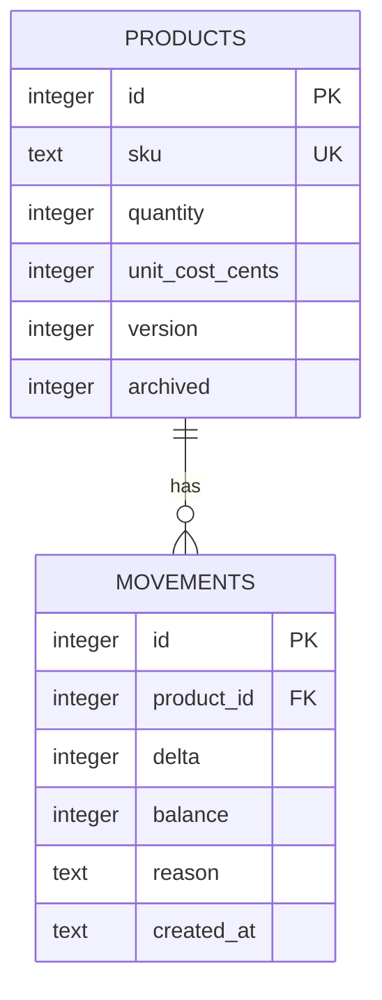

# Database schema and integrity

The repository initializes two application tables. SQLite also maintains internal sequence metadata. Connections enable foreign keys; queries bind parameters.

## products

| Column | SQLite type | Meaning/rule |
| --- | --- | --- |
| id | INTEGER PRIMARY KEY AUTOINCREMENT | Stable positive identity |
| sku | TEXT UNIQUE NOT NULL | Normalized; also checked case-insensitively by repository |
| name/category | TEXT NOT NULL | Current name and category |
| quantity | INTEGER NOT NULL CHECK >= 0 | Current whole-unit balance |
| unit_cost_cents | INTEGER NOT NULL CHECK >= 0 | Current PHP centavos per unit |
| reorder_level | INTEGER NOT NULL CHECK >= 0 | Alert threshold |
| version | INTEGER NOT NULL DEFAULT 1 | Increments on edits, stock and archive |
| archived | INTEGER NOT NULL DEFAULT 0 | 0 active, 1 archived |

## movements

| Column | SQLite type | Meaning |
| --- | --- | --- |
| id | INTEGER PRIMARY KEY AUTOINCREMENT | Newest-first ordering |
| product_id | INTEGER NOT NULL, foreign key | products.id |
| sku/name | TEXT NOT NULL | Identity snapshots at event time |
| delta | INTEGER NOT NULL | Signed stock change; zero for archive |
| balance | INTEGER NOT NULL | Quantity after event |
| reason | TEXT NOT NULL | Operator reason or system event |
| created_at | TEXT NOT NULL | ISO 8601 timestamp |

A movement records a stock change or archival event. Opening +10 yields 10; receipt +5 yields 15; issue -12 yields 3. Metadata edits do not create movements; this is not a complete field-change audit. Archival preserves product/history and reserves the SKU.

## Enforcement

The dispatcher parses input; shared validators protect service and direct repository calls. The repository additionally enforces active state, uniqueness, versions and balance bounds inside transactions. SQL constraints enforce basic nullability, uniqueness and nonnegative amounts. Text length/type rules are application rules, not all SQL CHECK constraints. Manual SQL editing can bypass them and is unsupported.

Stock update and movement insertion commit or roll back together. Opening quantity above zero creates an opening movement; zero does not. Archive writes a zero-delta event. New timestamps are aware UTC. Legacy naive timestamps are preserved and shown as local* because their actual timezone is unknown.

## Migration and backup

Supported migration: unit_costs_cents -> unit_cost_cents. IDs, values, movements and indexes are preserved. A unique `<stem>.before-unit-cost-migration-*.db` snapshot is made beside the database through SQLite's backup API before renaming. Ambiguous schemas fail clearly. Tests exercise preservation and failure rollback.

Exit all application instances before manual backup. Copy the selected closed database to a safe folder; copying only the main file of a live WAL database may miss data. Keep pre-migration snapshots. For manual restore, close all instances, retain current data separately, and replace the chosen database with a known valid backup. To inspect a backup use app.py --db with a copied path. CSV omits archives, history, IDs and versions and cannot restore a database.
