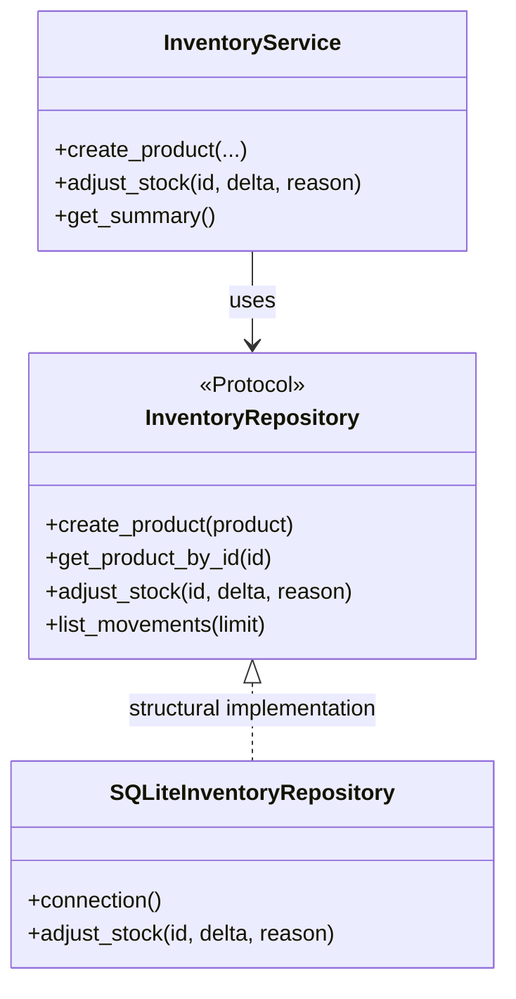

# Design pattern: Repository

Repository separates persistence from business rules through a collection-like contract. The service needs to create, find and update products without embedding SQLite queries in each operation. One repository owns transaction integrity and isolated service tests can use a fake.

[View diagram](diagrams/repository.svg)

## Source walkthrough

- backend/repository_interface.py defines InventoryRepository as a Protocol. Ellipses declare interface methods; they are intentional, not unfinished application code.
- backend/inventory_service.py receives that contract in its constructor and contains no SQL.
- backend/sqlite_repository.py implements real schema, locking, migration and persistence.
- application_connection.py constructs and injects the concrete repository.
- tests/test_inventory_service.py supplies an in-memory fake for the subset of methods those tests exercise. It is not a production-complete storage implementation.

InventoryService.adjust_stock validates the request and delegates. The SQLite implementation locks, re-reads the balance, writes stock and movement together, and returns a Product. The service does not open database connections.

## Comparison

| Alternative | Fit/tradeoff |
| --- | --- |
| Repository | Central SQL/integrity rules and replaceable storage contract; adds an interface and forwarding methods |
| Active Record | Puts save/query methods on Product, coupling data objects and service tests to storage |
| Singleton connection | Shares a global connection but does not separate rules from SQL; makes isolation and transaction ownership harder |

Repository addresses the real persistence boundary. A global Singleton is unnecessary because startup already builds one service/repository pair per menu session. The exchange client's injectable fetcher supports deterministic API tests without adding unnecessary formal patterns.

## Evidence

The service tests exercise a fake; test_sqlite_integration covers real persistence, rollback and competing writes. test_schema_migration and test_repository_validation cover additional storage invariants. See evidence/test-results.txt for actual passing cases. Editable Mermaid and SVG diagrams are in docs/diagrams.
